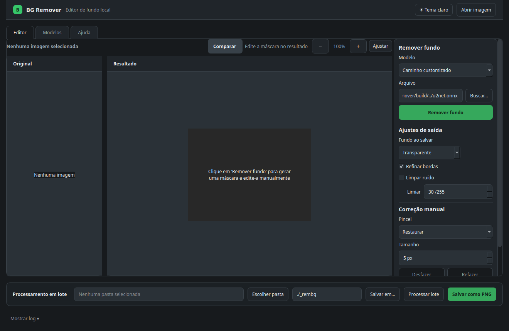

# BG Remover

Remova o fundo de imagens no seu computador — sem contas, créditos ou envio de arquivos para serviços externos.

O BG Remover é um aplicativo desktop em C++ e Qt que usa U²-Net através do ONNX Runtime para criar PNGs com transparência, processar pastas inteiras e corrigir detalhes manualmente com pincel.



## Download pronto (sem compilar)

A página de [**Releases**](https://github.com/MarielCarlosFrias/bg-remover/releases) tem pacotes gerados automaticamente pelo CI, com verificação de checksums:

- **Windows x64:** ZIP portátil — extraia e execute `bg_remover_gui.exe` (Qt, ONNX Runtime e o modelo leve já incluídos).
- **Debian/Ubuntu:** pacote `.deb` (depende de `libqt6widgets6`).

## Por que usar?

- **Privado por definição:** a imagem e a inferência ficam na sua máquina.
- **Pronto para trabalhar:** abra uma imagem, remova o fundo, ajuste o que for preciso e exporte em PNG.
- **Preciso onde importa:** amplie a pré-visualização e use o pincel para restaurar cabelo, roupa ou contornos, ou apagar resíduos.
- **Feito para volume:** processe uma pasta inteira pela interface ou pela linha de comando.
- **Sem dependência de GPU:** funciona em CPU, inclusive em máquinas sem placa de vídeo dedicada.

## Funcionalidades

- Remoção de fundo com **U²-Netp**, **U²-Net**, **Silueta**, **ISNet** e outros — instale novos modelos pela aba **Modelos**, com download integrado.
- Inferência numa **thread separada**: a janela nunca bloqueia durante o processamento.
- Processamento em lote com progresso, log, **botão de cancelar** e nomes de saída que nunca sobrescrevem arquivos existentes.
- Fundo transparente, branco, preto ou uma cor personalizada.
- Refinamento de bordas e limpeza de ruído com limiar ajustável.
- Edição manual da máscara com modos **Restaurar** e **Apagar**.
- **Desfazer/Refazer multi-nível** (Ctrl+Z / Ctrl+Y) e atalhos de teclado (Ctrl+O, Ctrl+S, Ctrl+±, Ctrl+0).
- **Arraste e solte** imagens (abre) ou pastas (define o lote) sobre a janela.
- **Tema escuro e claro** com alternância e persistência; preferências salvas (pastas, modelo, geometria).
- Zoom de 50% a 400% **centrado no cursor** (Ctrl + roda do mouse).
- CLI para automação em scripts (`bg_remover_cli --help`).
- Pacotes preparados para Debian/Ubuntu e Windows x64.

## Como funciona

1. A imagem é preparada no formato esperado pelo modelo (320 × 320, RGB normalizado).
2. O ONNX Runtime executa o modelo localmente e retorna um mapa que separa o objeto principal do fundo.
3. O mapa é redimensionado para a resolução original e aplicado como canal alpha.
4. Se necessário, a máscara recebe filtros de borda/ruído e pode ser corrigida com o pincel.
5. O resultado é exportado como PNG transparente ou composto numa cor sólida.

O mesmo pipeline é usado pela interface, pelo lote e pelo CLI, para que os resultados sejam consistentes em todos os fluxos.

## Começar rapidamente (compilar do código)

### Linux (Debian/Ubuntu)

Instale os requisitos de desenvolvimento:

```bash
sudo apt install build-essential cmake qt6-base-dev qt6-base-private-dev
```

Compile. O CMake baixa o ONNX Runtime automaticamente e de forma verificada:

```bash
cmake -S . -B build -DBG_REMOVER_FETCH_ONNX_RUNTIME=ON
cmake --build build --parallel
```

Baixe o modelo leve na raiz do projeto:

```bash
wget https://github.com/danielgatis/rembg/releases/download/v0.0.0/u2netp.onnx
```

Abra o aplicativo:

```bash
./build/bg_remover_gui
```

### Windows

Os releases incluem um ZIP portátil x64. Extraia-o e execute `bg_remover_gui.exe`; o pacote contém Qt, ONNX Runtime e o modelo leve.

Para compilar a partir do código-fonte, use Visual Studio 2022, CMake e Qt 6 para MSVC:

```powershell
cmake -S . -B build -G "Visual Studio 17 2022" -A x64 `
  -DINSTALLED=ON -DBG_REMOVER_FETCH_ONNX_RUNTIME=ON
cmake --build build --config Release --parallel
```

## Utilização

### Interface gráfica

1. Clique em **Abrir imagem** (ou arraste uma imagem para a janela).
2. Escolha o modelo e clique em **Remover fundo**.
3. Use `+`, `−`, **Ajustar** ou Ctrl + roda do mouse para aproximar e enquadrar.
4. Para pequenos erros, escolha **Restaurar** ou **Apagar** e pinte diretamente sobre o resultado; Ctrl+Z desfaz.
5. Clique em **Salvar como PNG**.

### Gerenciar modelos (aba Modelos)

Na aba **Modelos**, no topo da janela, escolha um modelo do catálogo e clique em **Descarregar**. Os arquivos ficam no diretório de dados do aplicativo (`~/.local/share/bg-remover/models` no Linux) e passam a aparecer no seletor de modelos da aba Editor, além de serem encontrados automaticamente pelo CLI. Modelos maiores (ISNet, U²-Net completo) geram recortes melhores em cabelo e contornos finos; o U²-Netp continua sendo o padrão leve. Os downloads usam HTTPS e os modelos com hash conhecido têm verificação SHA256; qualquer modelo pode ser removido do disco na mesma aba.

### Processamento em lote

Na barra inferior, escolha a pasta de entrada e a pasta de saída, depois clique em **Processar lote** (o botão vira **Cancelar lote** durante a execução). As imagens geradas recebem o sufixo `_rembg`; se já existir um arquivo com esse nome, o aplicativo cria uma variação numerada em vez de sobrescrevê-lo.

### Linha de comando

```bash
./build/bg_remover_cli <pasta_entrada> [pasta_saida] [modelo.onnx]
```

Se não indicar o modelo, a GUI e o CLI procuram `u2netp.onnx` junto do executável, no diretório de instalação, nos modelos instalados pela aba Modelos e por fim no diretório atual.

## Testes

```bash
ctest --test-dir build --output-on-failure
```

O projeto inclui testes de pós-processamento, do planejamento de lote (BatchPlan) e de inferência. A integração contínua compila e testa Linux e Windows x64; no Windows, também valida se o ZIP final contém as DLLs e plugins necessários.

## Criar um pacote Linux

```bash
cmake -S . -B build-release -DINSTALLED=ON \
  -DBG_REMOVER_FETCH_ONNX_RUNTIME=ON \
  -DBG_REMOVER_BUNDLE_MODELS=ON
cmake --build build-release --parallel
cd build-release
cpack -G DEB
```

`BG_REMOVER_BUNDLE_MODELS=ON` exige que `u2netp.onnx` esteja na raiz, impedindo a criação de um pacote que não funciona.

## Estrutura do projeto

```text
bg-remover/
├── .github/workflows/        # CI e releases Linux/Windows
├── backgroundremover.*       # Inferência ONNX e geração da máscara
├── imagepostprocessor.*      # Filtros alpha e composição do fundo
├── batchprocessor.* + batchplan.h  # Processamento de diretórios (CLI + GUI)
├── mainwindow.*              # Interface Qt (abas, lote, zoom)
├── maskeditcanvas.*          # Pincel e edição da máscara
├── modelmanager.*            # Aba Modelos: catálogo e download
├── helpwidget.*              # Aba Ajuda
├── apptheme.*                # Temas escuro/claro
├── main.cpp / main_cli.cpp   # Arranque da GUI e do CLI
└── test_*.cpp                # Testes automatizados
```

Os modelos, o runtime extraído, os diretórios de build e os resultados locais não entram no Git. Os releases automatizados obtêm o runtime e o modelo leve, verificam os respectivos checksums e criam os pacotes distribuíveis.

## Limitações atuais

- U²-Netp privilegia velocidade; cabelo e transparências muito finas podem precisar de correção manual. U²-Net oferece melhor segmentação, mas é substancialmente maior.
- O ZIP do Windows é gerado e verificado pelo CI (DLLs e plugins presentes), mas ainda **não foi testado numa instalação limpa do Windows** — se encontrar problemas, abra uma [issue](https://github.com/MarielCarlosFrias/bg-remover/issues).

## Créditos

Modelos [U²-Net](https://github.com/xuebinqin/U-2-Net) e arquivos ONNX distribuídos pelo projeto [rembg](https://github.com/danielgatis/rembg).
