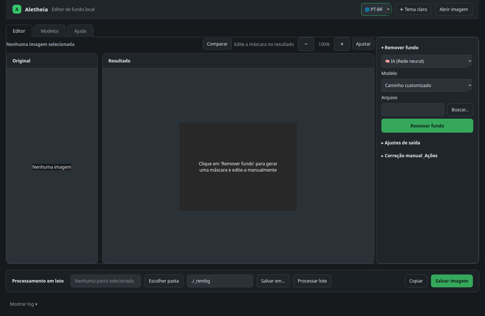
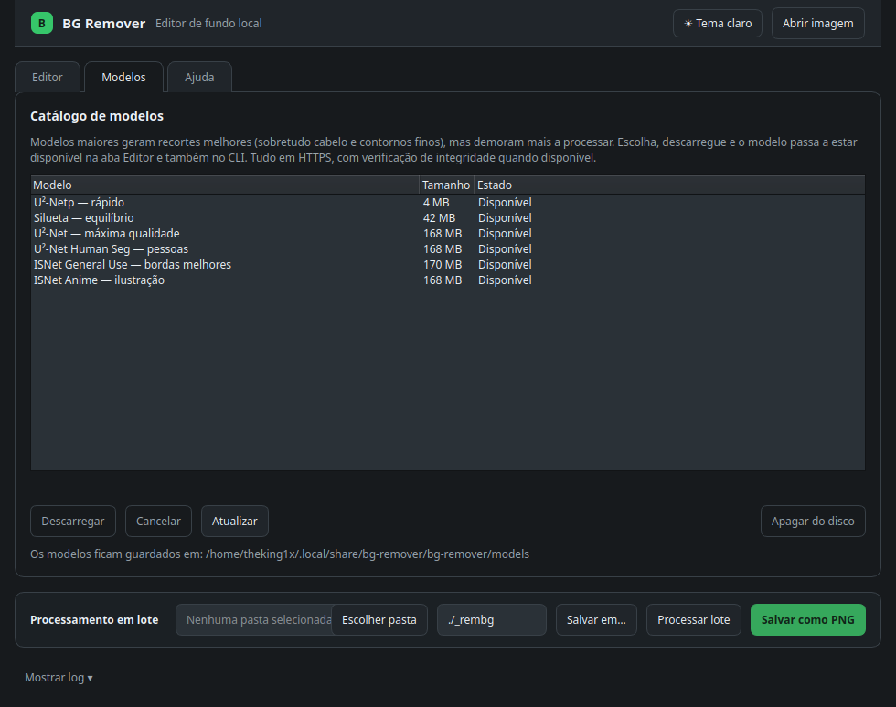
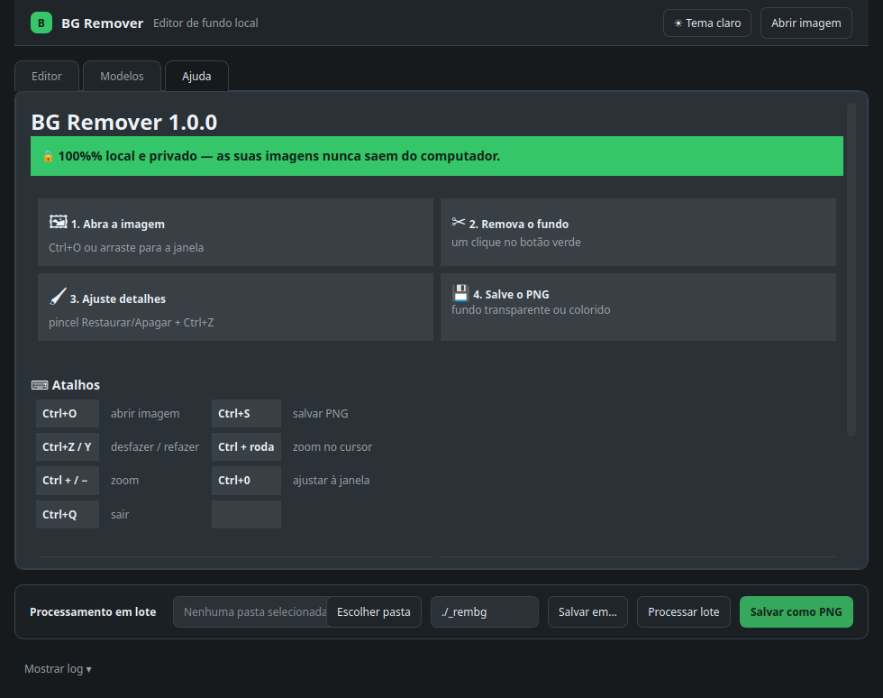

# Aletheia

[](README.md)
[](README.pt.md)
[](https://github.com/MarielCarlosFrias/aletheia/actions/workflows/ci.yml)
[](https://github.com/MarielCarlosFrias/aletheia/actions/workflows/release.yml)
[](LICENSE)
[](https://www.qt.io/)
[](#pre-built-downloads-no-compile-needed)

**Fast, private, 100% offline background removal for images.**  
Named after the ancient Greek concept **Aletheia** (*Ἀλήθεια* — the disclosure, un-veiling, or revealing of what was hidden by removing what obscures it).

Powered by modern deep learning models (U²-Net, BRIA RMBG, BiRefNet) and color-based Chroma Key / Pixel Art extraction, running natively in C++ with Qt 6 and ONNX Runtime.

No cloud uploads, no API subscriptions, no telemetry. Your photos and data never leave your device.



---

## ⚡ Key Highlights

- 🔒 **100% Private & Local**: All inference and image processing occur strictly on your local machine.
- 🚀 **CPU-Optimized**: High-performance ONNX Runtime inference without requiring a dedicated or expensive GPU.
- 🎨 **Chroma Key & Pixel Art Mode**: Dedicated color removal tool for 2D sprites, pixel art, green screen, or solid backgrounds with configurable tolerance and contiguous flood-fill.
- 🤖 **One-Click Model Catalog**: Built-in downloader for state-of-the-art models (**U²-Netp**, **U²-Net**, **BRIA RMBG 1.4**, **BRIA RMBG 2.0**, **BiRefNet**, **Silueta**, **ISNet**) with automatic SHA256 integrity verification.
- ✂️ **Export & Finishing Tools**:
  - **Auto-Crop**: Trim excess transparent margins around your subject automatically.
  - **Sticker Effect**: Add customizable solid outline borders (width and color).
  - **Drop Shadow**: Generate smooth, adjustable drop shadows with opacity and blur controls.
- 🖌️ **Manual Mask Refinement**: Brush tool with **Restore** and **Erase** modes for fine hair, delicate contours, or stray artifacts.
- ↩️ **Multi-Level Undo / Redo**: Freely experiment with changes using `Ctrl+Z` and `Ctrl+Y`.
- 📁 **High-Speed Batch Processing**: Convert entire folders of images in bulk via the GUI or CLI with non-blocking worker threads.
- 📋 **Seamless Desktop Workflow**: Paste images directly from clipboard (`Ctrl+V`), copy results (`Ctrl+C`), and drag-and-drop images in or out of the application.
- 🌓 **Adaptive Dark & Light Themes**: Clean native look with persistent settings across sessions.

---

## 📥 Pre-Built Downloads (No Compile Needed)

Ready-to-use binaries are automatically generated and tested for every release on GitHub:

👉 [**Download the Latest Release (v1.2.0)**](https://github.com/MarielCarlosFrias/aletheia/releases/latest)

| Platform | Package | Description |
| :--- | :--- | :--- |
| **Windows** | `aletheia_*_win64.zip` | Portable standalone package. Extract and run `aletheia.exe` (Qt, ONNX Runtime and default model included). |
| **macOS** | `aletheia_*_macos_universal2.zip` | Universal2 `Aletheia.app` bundle for both **Apple Silicon (M1/M2/M3/M4)** and **Intel** Macs. Drag to `/Applications`. CLI included. |
| **Linux (Universal)** | `aletheia_*_x86_64.AppImage` | Standalone executable for any modern Linux distro. Run `chmod +x` and execute. |
| **Ubuntu / Debian** | `aletheia_*_amd64.deb` | Native Debian package integrating desktop launchers, man page, and system icons. |

To verify the integrity of any downloaded asset against the official release checksums:
```bash
sha256sum --check SHA256SUMS
```

---

## 🛠️ Modes of Operation

### 1. AI Segmentation Mode
Uses trained deep learning neural networks to segment foreground objects from complex backgrounds (portraits, products, animals, nature):
- **U²-Netp (Default)**: Ultra-fast and lightweight (~4.5 MB), ideal for standard everyday tasks on low-power CPUs.
- **BRIA RMBG 1.4 & 2.0**: High-precision segmentation developed for professional product photography and portraits.
- **BiRefNet**: State-of-the-art bilateral reference network for intricate edges and fine details.
- **ISNet / U²-Net (Full)**: High-resolution segmentation for complex outlines.

### 2. Color / Chroma Key & Pixel Art Mode
For pixel art graphics, game sprites, green screens, or illustrations on solid backgrounds where AI models might blur crisp pixel borders:
- **Exact Color Matching**: Perfect 1:1 color keying preserving pixel-art boundaries.
- **Tolerance Slider**: Smooth adjustment for compressed JPEGs or subtle gradients.
- **Contiguous Mode**: Remove only background connected to the image edges, preserving inner colors of characters or objects.
- **Auto-Detect**: One-click corner color sampling.

---

## 🖼️ Application Overview

### Interactive Editor
- **Split Slider**: Drag across the canvas to compare original vs cutout side-by-side.
- **Zoom & Pan**: Zoom from 50% to 400% centered on your mouse cursor (`Ctrl + Wheel`).
- **Background Choice**: Inspect cutouts over checkerboard transparency, solid white, dark, or custom colored backgrounds.
- **Direct Drag-Out**: Drag the finished cutout straight from the preview canvas into your file manager, Discord, browser, or photo editor.

### Model Manager Tab
Download, verify, or remove additional models with a single click. Downloaded models are stored locally (`~/.local/share/aletheia/models` on Linux, `%APPDATA%/aletheia/models` on Windows) and instantly available across both GUI and CLI (with automatic fallback to legacy directories).



### Batch Processing
Select an input folder, an output destination, and process hundreds of images in sequence.
- Non-blocking background worker with progress bar, log, and **Cancel** button.
- Collision-free naming: existing output files are never overwritten (automatic numbered variations like `_rembg_1.png`).

### Integrated Help & Shortcuts
Press `F1` or open the **Help** tab for a quickstart guide, tool explanations, and complete shortcut references.



---

## ⌨️ Keyboard Shortcuts

| Shortcut | Action |
| :--- | :--- |
| `Ctrl+O` | Open image file |
| `Ctrl+V` | Paste image from clipboard |
| `Ctrl+S` | Save processed image |
| `Ctrl+C` / `Ctrl+Shift+C` | Copy cutout to clipboard |
| `Ctrl+Z` | Undo mask edit |
| `Ctrl+Y` / `Ctrl+Shift+Z` | Redo mask edit |
| `Ctrl+D` | Run background removal |
| `Ctrl + Wheel` / `Ctrl+±` | Zoom in / Zoom out |
| `Ctrl+0` | Fit image to window |
| `F1` | Open Help tab |

---

## 💻 Command Line Interface (CLI)

The package includes a standalone CLI binary (`aletheia_cli`) suitable for headless servers, build scripts, and automation:

```bash
# Basic batch folder processing
aletheia_cli /path/to/input_folder -o /path/to/output_folder

# Use a specific ONNX model and export to WebP
aletheia_cli /path/to/input_folder -o /path/to/output -m path/to/model.onnx -f webp

# Positional legacy syntax
aletheia_cli <input_folder> [output_folder] [model.onnx]

# Check help and version
aletheia_cli --help
aletheia_cli --version
```

---

## 🔨 Building from Source

### Prerequisites
- Modern C++17 compiler (GCC 11+, Clang 14+, or MSVC 2022)
- **CMake 3.20+**
- **Qt 6** (`QtCore`, `QtGui`, `QtWidgets`, `QtNetwork`, `QtConcurrent`)
- Optional: `qt6-image-formats-plugins` for WebP read/write support

### Linux (Ubuntu / Debian)
```bash
sudo apt update && sudo apt install -y build-essential cmake qt6-base-dev qt6-image-formats-plugins
git clone https://github.com/MarielCarlosFrias/aletheia.git
cd aletheia
cmake -S . -B build -DCMAKE_BUILD_TYPE=Release -DBG_REMOVER_FETCH_ONNX_RUNTIME=ON
cmake --build build -j 2
./build/aletheia
```

### Windows (Visual Studio 2022)
```powershell
cmake -S . -B build -G "Visual Studio 17 2022" -A x64 -DINSTALLED=ON -DBG_REMOVER_FETCH_ONNX_RUNTIME=ON
cmake --build build --config Release --parallel
```

### macOS (Universal2)
```bash
cmake -S . -B build -DCMAKE_BUILD_TYPE=Release -DINSTALLED=ON \
  -DBG_REMOVER_FETCH_ONNX_RUNTIME=ON \
  -DCMAKE_OSX_ARCHITECTURES="x86_64;arm64"
cmake --build build --parallel
open build/Aletheia.app
```

---

## 📁 Repository Structure

The project follows a clean, modular C++/Qt layout:

```text
aletheia/
├── src/
│   ├── core/                        # UI-independent engine
│   │   ├── backgroundremover.cpp/.h # ONNX inference & tensor processing
│   │   ├── imagepostprocessor.cpp/.h# Chroma Key, Alpha filters & composition
│   │   ├── batchprocessor.cpp/.h    # Multithreaded batch pipeline
│   │   ├── batchplan.h              # Batch file validation & safety
│   │   ├── modelmanager.cpp/.h      # Model catalog & download management
│   │   ├── modelvalidator.cpp/.h    # Checksum & file integrity validation
│   │   ├── modelpathresolver.cpp/.h # Cross-platform model path resolution
│   │   ├── savepath.h               # Output formatting & collision avoidance
│   │   ├── processingoptions.h      # Unified processing options struct
│   │   └── i18n.h                   # Lightweight multilingual translation
│   ├── gui/                         # Qt 6 Widgets GUI
│   │   ├── main.cpp                 # GUI entry point
│   │   ├── mainwindow.cpp/.h        # Main application window & tabs
│   │   ├── maskeditcanvas.cpp/.h    # Interactive mask brush canvas
│   │   ├── helpwidget.cpp/.h        # Embedded help & documentation tab
│   │   └── apptheme.cpp/.h          # Dark/Light theme palette engine
│   └── cli/                         # Command Line Interface
│       └── main_cli.cpp             # CLI entry point
├── tests/                           # Automated CTest test suite
│   ├── test_postprocessing.cpp      # Color removal & post-processing tests
│   ├── test_batchprocessor.cpp      # Batch engine test
│   ├── test_batchplan.cpp           # Plan & collision test
│   ├── test_modelpath.cpp           # Path resolution test
│   ├── test_modelvalidator.cpp      # SHA256 integrity test
│   ├── test_savepath.cpp            # Output extension test
│   ├── test_imageformats.cpp        # Image format & WebP test
│   ├── test_inference.cpp           # ONNX inference smoke test
│   └── test_gui.cpp                 # Headless offscreen GUI smoke tests
├── assets/                          # OS integration assets
│   ├── aletheia.svg                 # Application vector icon
│   ├── aletheia.desktop             # Linux desktop launcher entry
│   ├── aletheia_cli.1               # UNIX man page documentation
│   └── io.github.MarielCarlosFrias.Aletheia.metainfo.xml # AppStream metadata
├── docs/                            # Screenshots & documentation media
├── .github/                         # Workflows for CI & automated multiplatform releases
├── CMakeLists.txt                   # Root CMake build configuration
├── README.md                        # English documentation (default)
└── README.pt.md                     # Documentação em Português
```

---

## 🧪 Running Tests

Run the full automated test suite using `ctest`:
```bash
ctest --test-dir build --output-on-failure
```

---

## 📄 License & Credits

- **License**: Released under the permissive [MIT License](LICENSE).
- **Core AI Models**:
  - [U²-Net](https://github.com/xuebinqin/U-2-Net) by Xuebin Qin et al.
  - ONNX distribution models by [rembg](https://github.com/danielgatis/rembg).
  - [BRIA RMBG-1.4 / 2.0](https://bria.ai/) by BRIA AI.
  - [BiRefNet](https://github.com/ZhengPeng7/BiRefNet) by Peng Zheng et al.
