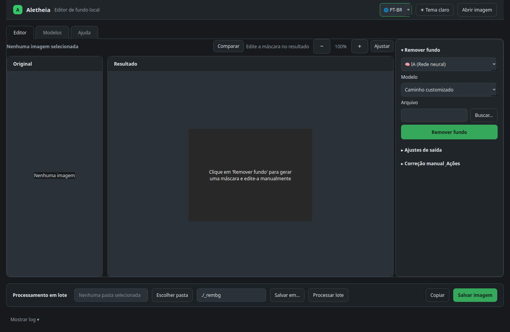
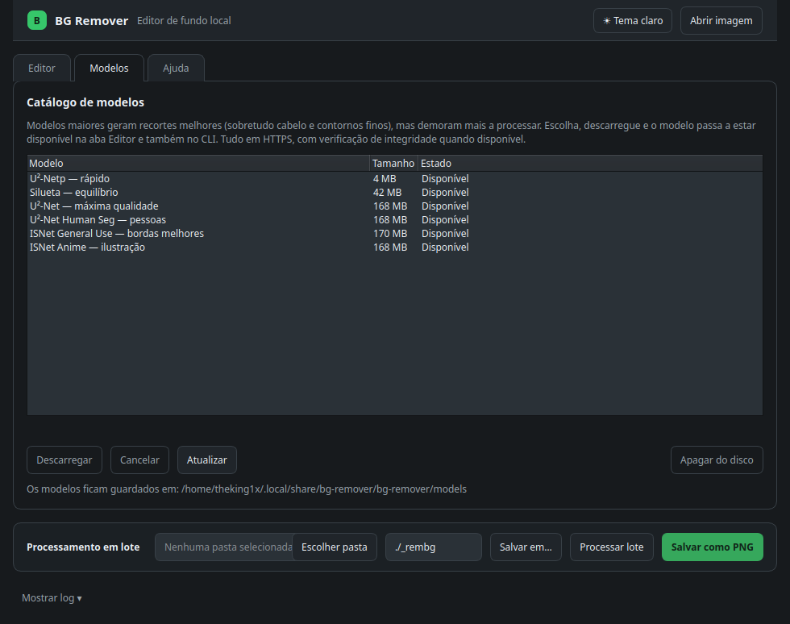
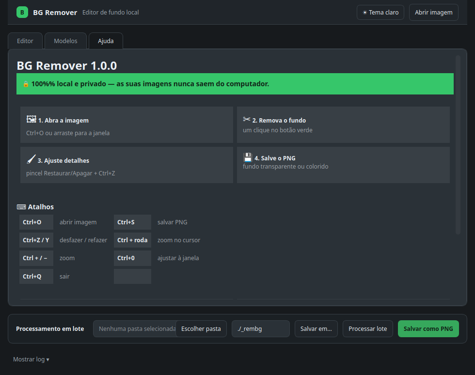

# Aletheia

[](README.md)
[](README.pt.md)
[](https://github.com/MarielCarlosFrias/bg-remover/actions/workflows/ci.yml)
[](https://github.com/MarielCarlosFrias/bg-remover/actions/workflows/release.yml)
[](LICENSE)
[](https://www.qt.io/)
[](#download-pronto-sem-compilar)

**Remoção de fundo de imagens rápida, privada e 100% offline.**  
Inspirado no conceito da Grécia Antiga **Aletheia** (*Ἀλήθεια* — o des-velamento, revelação ou descoberta da verdadeira forma ao retirar o que a encobre).

O Aletheia é um aplicativo desktop nativo em C++17 e Qt 6 que executa redes neurais profundas (U²-Net, BRIA RMBG, BiRefNet) via ONNX Runtime e algoritmos de remoção por cor (Chroma Key / Pixel Art) diretamente no seu computador.

Sem envio de fotos para a nuvem, sem assinaturas ou APIs pagas, sem necessidade de cadastro.



---

## ⚡ Destaques

- 🔒 **100% Privado e Local**: Nenhuma foto ou dado sai do seu computador.
- 🚀 **Otimizado para CPU**: Execução veloz em processadores modernos sem exigir GPU dedicada ou cara.
- 🎨 **Modo Chroma Key & Pixel Art**: Remoção cirúrgica por cor com tolerância ajustável e modo contíguo, ideal para sprites 2D e ilustrações sem borrar pixels.
- 🤖 **Catálogo Integrado de Modelos**: Download com 1 clique de modelos de ponta (**U²-Netp**, **U²-Net**, **BRIA RMBG 1.4/2.0**, **BiRefNet**, **Silueta**, **ISNet**) com verificação automática de integridade SHA256.
- ✂️ **Efeitos de Finalização**:
  - **Recorte Automático (Auto-Crop)**: Remove margens transparentes vazias automaticamente.
  - **Efeito Adesivo (Sticker)**: Adiciona borda sólida ao redor do recorte com espessura e cor configuráveis.
  - **Sombra Projetada (Drop Shadow)**: Cria sombras suaves com controles de desfoque e opacidade.
- 🖌️ **Retoque Manual da Máscara**: Pincel interativo com modos **Restaurar** e **Apagar** para cabelos, arestas finas e reflexos.
- ↩️ **Desfazer / Refazer Multi-nível**: Teste alterações com segurança via `Ctrl+Z` e `Ctrl+Y`.
- 📁 **Processamento em Lote de Alto Desempenho**: Converta pastas completas em lote pela interface ou via linha de comando em threads em segundo plano.
- 📋 **Fluxo Ágil de Trabalho**: Cole imagens da área de transferência (`Ctrl+V`), copie o resultado (`Ctrl+C`) e arraste arquivos para dentro e para fora do programa.
- 🌓 **Temas Escuro e Claro**: Interface moderna com persistência automática de preferências.

---

## 📥 Download Pronto (Sem Compilar)

Binários prontos para uso são gerados e testados automaticamente em cada versão:

👉 [**Baixar a Versão Mais Recente (v1.2.0)**](https://github.com/MarielCarlosFrias/bg-remover/releases/latest)

| Plataforma | Pacote | Descrição |
| :--- | :--- | :--- |
| **Windows** | `aletheia_*_win64.zip` | Pacote portátil standalone. Extraia e execute `aletheia.exe` (Qt, ONNX Runtime e modelo padrão inclusos). |
| **macOS** | `aletheia_*_macos_universal2.zip` | Pacote universal2 `Aletheia.app` para **Apple Silicon (M1/M2/M3/M4)** e Macs **Intel**. Arraste para `/Applications`. CLI incluso. |
| **Linux (Universal)** | `aletheia_*_x86_64.AppImage` | Executável único compatível com as principais distribuições Linux. Dê `chmod +x` e execute. |
| **Ubuntu / Debian** | `aletheia_*_amd64.deb` | Pacote nativo Debian com integração no menu de aplicativos, ícones e manual man. |

Para verificar a integridade de qualquer download usando as somas SHA256 oficiais:
```bash
sha256sum --check SHA256SUMS
```

---

## 🛠️ Modos de Operação

### 1. Segmentação por Inteligência Artificial
Usa redes neurais profundas pré-treinadas para segmentar o primeiro plano em fotos com fundos complexos (retratos, produtos, animais):
- **U²-Netp (Padrão)**: Ultra-rápido e leve (~4.5 MB), ideal para o dia a dia mesmo em computadores modestos.
- **BRIA RMBG 1.4 e 2.0**: Alta precisão voltada para fotografia de estúdio e e-commerce.
- **BiRefNet**: Rede de referência bilateral de última geração para arestas detalhadas e cabelos.
- **ISNet / U²-Net Completo**: Segmentação em alta resolução para contornos refinados.

### 2. Remoção por Cor / Chroma Key e Pixel Art
Ideal para gráficos 2D, sprites de jogos, telas verdes ou ilustrações com fundo sólido:
- **Casamento de Cor 1:1**: Preserva bordas pixel-perfect sem a suavização das IAs.
- **Controle de Tolerância**: Ajuste suave para imagens comprimidas ou leves gradientes.
- **Modo Contíguo (Flood-fill)**: Remove apenas o fundo conectado às bordas, mantendo intactas as cores internas do personagem.
- **Auto-Detecção**: Seleção de cor automática baseada nos cantos da imagem.

---

## 🖼️ Visão Geral da Aplicação

### Editor Interativo
- **Divisor Antes/Depois**: Arraste a linha divisória sobre a tela para comparar a foto original e o recorte.
- **Zoom & Pan**: De 50% a 400% centrado na posição do cursor do mouse (`Ctrl + Roda do mouse`).
- **Fundo de Pré-visualização**: Alterne entre xadrez de transparência, branco, escuro ou cor personalizada.
- **Arraste Direto para Fora**: Arraste a imagem recortada diretamente da tela para o Discord, navegador ou explorador de arquivos.

### Aba Modelos
Baixe, verifique ou apague modelos com um clique. Os arquivos são armazenados localmente (`~/.local/share/aletheia/models` no Linux, `%APPDATA%/aletheia/models` no Windows) e ficam imediatamente disponíveis tanto na interface gráfica quanto no CLI (com suporte retrocompatível aos caminhos antigos).



### Processamento em Lote
Indique a pasta de entrada e a pasta de saída para processar centenas de imagens em fila.
- Operação assíncrona em segundo plano com barra de progresso e botão **Cancelar**.
- Nomenclatura sem colisões: arquivos existentes nunca são sobrescritos (sufixos automáticos `_rembg_1.png`).

### Ajuda e Atalhos Integrados
Pressione `F1` ou abra a aba **Ajuda** para acessar o manual rápido, explicação de ferramentas e tabela de atalhos.



---

## ⌨️ Atalhos de Teclado

| Atalho | Ação |
| :--- | :--- |
| `Ctrl+O` | Abrir arquivo de imagem |
| `Ctrl+V` | Colar imagem da área de transferência |
| `Ctrl+S` | Salvar imagem processada |
| `Ctrl+C` / `Ctrl+Shift+C` | Copiar recorte para a área de transferência |
| `Ctrl+Z` | Desfazer retoque da máscara |
| `Ctrl+Y` / `Ctrl+Shift+Z` | Refazer retoque da máscara |
| `Ctrl+D` | Processar / Recalcular recorte |
| `Ctrl + Roda` / `Ctrl+±` | Aumentar / Diminuir zoom |
| `Ctrl+0` | Ajustar imagem à janela |
| `F1` | Abrir aba de Ajuda |

---

## 💻 Linha de Comando (CLI)

O executável standalone `aletheia_cli` permite automação em scripts, servidores sem tela e pipelines de processamento:

```bash
# Processar uma pasta em lote
aletheia_cli /caminho/para/fotos -o /caminho/para/saida

# Especificar modelo ONNX e formato WebP
aletheia_cli /caminho/para/fotos -o /caminho/para/saida -m modelo.onnx -f webp

# Sintaxe posicional clássica
aletheia_cli <pasta_entrada> [pasta_saida] [modelo.onnx]

# Consultar versão e opções disponíveis
aletheia_cli --help
aletheia_cli --version
```

---

## 🔨 Compilar a Partir do Código-Fonte

### Pré-requisitos
- Compilador C++17 (GCC 11+, Clang 14+ ou MSVC 2022)
- **CMake 3.20+**
- **Qt 6** (`QtCore`, `QtGui`, `QtWidgets`, `QtNetwork`, `QtConcurrent`)
- Opcional: `qt6-image-formats-plugins` para suporte ao formato WebP

### Linux (Ubuntu / Debian)
```bash
sudo apt update && sudo apt install -y build-essential cmake qt6-base-dev qt6-image-formats-plugins
git clone https://github.com/MarielCarlosFrias/bg-remover.git
cd bg-remover
cmake -S . -B build -DCMAKE_BUILD_TYPE=Release -DBG_REMOVER_FETCH_ONNX_RUNTIME=ON
cmake --build build -j 2
./build/aletheia
```

### Windows (Visual Studio 2022)
```powershell
cmake -S . -B build -G "Visual Studio 17 2022" -A x64 -DINSTALLED=ON -DBG_REMOVER_FETCH_ONNX_RUNTIME=ON
cmake --build build --config Release --parallel
```

### macOS (Universal2)
```bash
cmake -S . -B build -DCMAKE_BUILD_TYPE=Release -DINSTALLED=ON \
  -DBG_REMOVER_FETCH_ONNX_RUNTIME=ON \
  -DCMAKE_OSX_ARCHITECTURES="x86_64;arm64"
cmake --build build --parallel
open build/Aletheia.app
```

---

## 📁 Estrutura do Repositório

```text
aletheia/
├── src/
│   ├── core/                        # Motor independente de UI
│   │   ├── backgroundremover.cpp/.h # Inferência ONNX e geração da máscara
│   │   ├── imagepostprocessor.cpp/.h# Filtros alpha, Chroma Key e composição
│   │   ├── batchprocessor.cpp/.h    # Processamento em lote assíncrono
│   │   ├── batchplan.h              # Plano de arquivos e validações
│   │   ├── modelmanager.cpp/.h      # Catálogo e download de modelos
│   │   ├── modelvalidator.cpp/.h    # Verificação de integridade/SHA256
│   │   ├── modelpathresolver.cpp/.h # Resolução de caminhos nos vários SOs
│   │   ├── savepath.h               # Extensão coerente com formato de saída
│   │   ├── processingoptions.h      # Opções unificadas de processamento
│   │   └── i18n.h                   # Deteção e mensagens multilíngue
│   ├── gui/                         # Interface gráfica (Qt6 Widgets)
│   │   ├── main.cpp                 # Ponto de entrada da GUI
│   │   ├── mainwindow.cpp/.h        # Janela principal, abas e controlos
│   │   ├── maskeditcanvas.cpp/.h    # Tela de retoque manual com pincel
│   │   ├── helpwidget.cpp/.h        # Aba Ajuda integrada
│   │   └── apptheme.cpp/.h          # Temas escuro/claro e estilos
│   └── cli/                         # Linha de comandos (CLI)
│       └── main_cli.cpp             # Ponto de entrada do executável CLI
├── tests/                           # Testes unitários automatizados (CTest)
│   ├── test_postprocessing.cpp      # Testes de filtros e remoção por cor
│   ├── test_batchprocessor.cpp      # Teste do processamento em lote
│   ├── test_batchplan.cpp           # Teste de planeamento de ficheiros
│   ├── test_modelpath.cpp           # Teste de resolução de caminhos
│   ├── test_modelvalidator.cpp      # Teste de validação de modelos
│   ├── test_savepath.cpp            # Teste de caminhos de salvamento
│   ├── test_imageformats.cpp        # Teste de formatos de imagem
│   ├── test_inference.cpp           # Teste de inferência do modelo leve
│   └── test_gui.cpp                 # Teste de fumo da interface offscreen
├── assets/                          # Ficheiros de integração com o sistema
│   ├── aletheia.svg                 # Ícone vetorial da aplicação
│   ├── aletheia.desktop             # Atalho de lançador Linux
│   ├── aletheia_cli.1               # Manual UNIX (man page)
│   └── io.github.MarielCarlosFrias.Aletheia.metainfo.xml # Metadados AppStream
├── docs/                            # Documentação e capturas de ecrã
├── .github/                         # Workflows de CI/CD e Releases
├── CMakeLists.txt                   # Configuração e regras de compilação
├── README.md                        # Documentação em Inglês
└── README.pt.md                     # Documentação em Português
```

---

## 🧪 Executar Testes

Execute a suíte de testes completa com o `ctest`:
```bash
ctest --test-dir build --output-on-failure
```

---

## 📄 Licença e Créditos

- **Licença**: Distribuído sob a licença permissiva [MIT](LICENSE).
- **Modelos de IA**:
  - [U²-Net](https://github.com/xuebinqin/U-2-Net) por Xuebin Qin et al.
  - Distribuição ONNX via [rembg](https://github.com/danielgatis/rembg).
  - [BRIA RMBG-1.4 / 2.0](https://bria.ai/) por BRIA AI.
  - [BiRefNet](https://github.com/ZhengPeng7/BiRefNet) por Peng Zheng et al.
